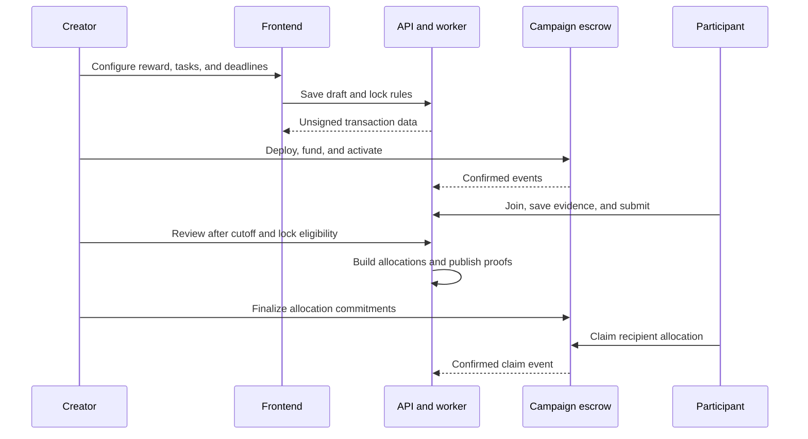

# Architecture

Oppor combines an offchain campaign workflow with onchain reward settlement. The frontend and backend use the same configured network, factory, and contract interfaces.

## Components

| Component | Responsibilities |
| --- | --- |
| React frontend | Wallet connection, creator configuration, evidence submission, review, transaction confirmation, and claim status |
| Rust API | SIWE sessions, validation, authorization, campaign mutations, evidence access, and unsigned transaction preparation |
| PostgreSQL | Campaign configuration, entries, review decisions, eligibility snapshots, allocation artifacts, durable jobs, and audit history |
| Redis | Shared rate limits and public listing cache |
| Allocation worker | Build deterministic allocations, generate Merkle proofs, publish immutable artifacts, and retry durable jobs |
| Chain indexer | Verify receipts and confirmed events before projecting contract state into the application |
| Private object storage | Participant evidence and immutable allocation artifacts accessed through short-lived signed URLs |
| Campaign factory | Deploy a dedicated non-upgradeable escrow and register it by creator and campaign key |
| Campaign escrow | Enforce reward funding, immutable configuration, deadlines, finalization, recipient claims, cancellation, and refunds |

## Campaign lifecycle

## Data and settlement

A PostgreSQL transaction commits related application changes and idempotency records together. Optimistic versions reject stale edits, while row locks serialize registration, review, and deadline-sensitive transitions. The indexer admits verified events before updating reward state; a client transaction callback alone does not establish a successful payment.

The application locks task configuration before creating the escrow. Merkle leaves bind the chain, escrow, campaign, index, recipient, asset, token ID, and quantity. Finalized manifests and eligibility snapshots have onchain hash commitments. Claimed allocations are tracked in the escrow bitmap to prevent repeat claims.

## Wallet and asset handling

The API prepares transaction data without user signing keys. Users authorize transactions through the frontend's EIP-1193 wallet connector. SIWE sessions are bound to the configured domain, wallet, chain, nonce, and expiry.

Reward amounts are integer strings in base units. Arc's native gas USDC uses 18 decimals, while its USDC ERC-20 interface uses 6 decimals; these represent the same underlying balance. ERC-721 allocations identify individual NFTs, and ERC-1155 campaigns use one configured token ID.

## Trust model

Social evidence is reviewed by the creator. The operator produces a reproducible server raffle and allocation artifacts. Creators finalize the distribution. The escrow enforces the finalized claim commitments and deadlines, but does not establish the fairness of review or the validity of social actions. See [security](../SECURITY.md).
